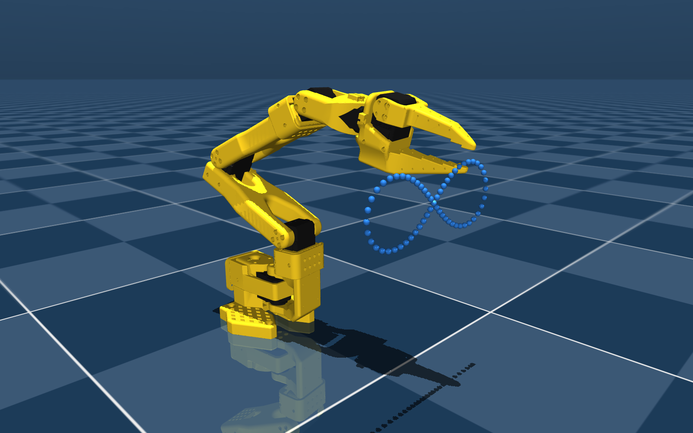

# SO-101 robot arm with LeRobot

A hands-on project with the [SO-101](https://github.com/TheRobotStudio/SO-ARM100)
low-cost robot arm and Hugging Face [LeRobot](https://github.com/huggingface/lerobot):
from motor setup to simulation, sim-to-real transfer and, later, imitation
learning with a camera.



## Progress

| Part | Status | Where |
|---|---|---|
| Setup: motor IDs, calibration, USB on WSL2 | Done | [docs/01-so101-setup-to-training.md](docs/01-so101-setup-to-training.md) |
| Lemniscate: inverse kinematics in MuJoCo, then on the real arm | Done | [lemniscate/](lemniscate/README.md) |
| Policy trained in simulation (joint states only), transferred to the real arm | Planned | |
| Camera + teleoperation (phone) → dataset → ACT policy | Planned | |

Highlights of the lemniscate part: same joint commands in simulation and on the
real arm, a read-only digital twin to check joint conventions, and a
step-by-step tuning of the servos that brings the real drawing from 5.1 mm to
2.1 mm mean error (simulation: 0.15 mm). See [lemniscate/README.md](lemniscate/README.md).

## Hardware and software

- SO-101 follower arm, 12 V version, Feetech STS3215 servos (no leader arm yet)
- Windows 11 + WSL2 (Ubuntu), USB forwarded with usbipd-win, no NVIDIA GPU
- LeRobot 0.6.2, MuJoCo 3.5.0, Python 3.12

## Setup

```bash
# Environment
conda create -y -n lerobot python=3.12
conda activate lerobot
conda install -y ffmpeg -c conda-forge

# LeRobot (not included in this repository)
git clone https://github.com/huggingface/lerobot.git
pip install -e "lerobot[feetech,core_scripts,training]"
pip install mujoco==3.5.0 matplotlib

# SO-101 simulation model (only the Simulation/SO101 folder)
git clone --depth 1 --filter=blob:none --sparse https://github.com/TheRobotStudio/SO-ARM100.git third_party/SO-ARM100
git -C third_party/SO-ARM100 sparse-checkout set Simulation/SO101
```

Connecting and calibrating the arm (including the WSL2/usbipd part) is
described step by step in [docs/01-so101-setup-to-training.md](docs/01-so101-setup-to-training.md).

## Repository layout

```
docs/          setup guide, from motor IDs to training (built up as the project goes)
scripts/       small tools for the real arm: check motors, wiggle joints, servo dead zone
lemniscate/    sim-to-real lemniscate: code, figures, run logs, write-up
lerobot/       LeRobot clone (not tracked)
third_party/   SO-101 MuJoCo model from TheRobotStudio (not tracked)
```

## Acknowledgements

- [LeRobot](https://github.com/huggingface/lerobot) by Hugging Face
- SO-101 design and MuJoCo/URDF model by [TheRobotStudio](https://github.com/TheRobotStudio/SO-ARM100)
- The lemniscate and IK code started from an exercise of the ETH Zürich robot-learning course (2026)
