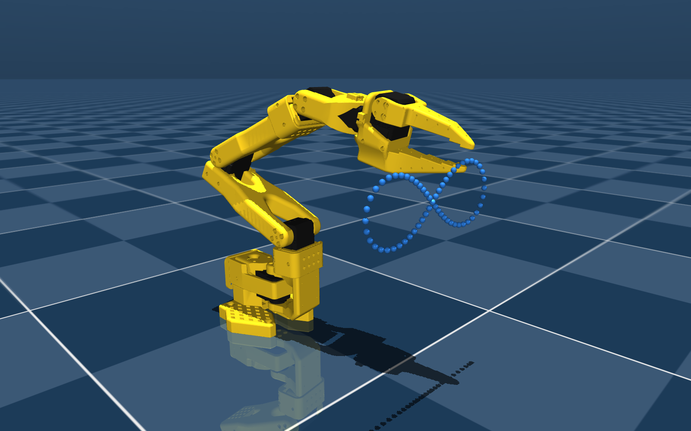
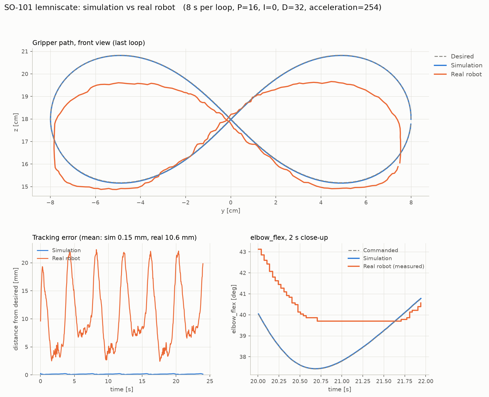
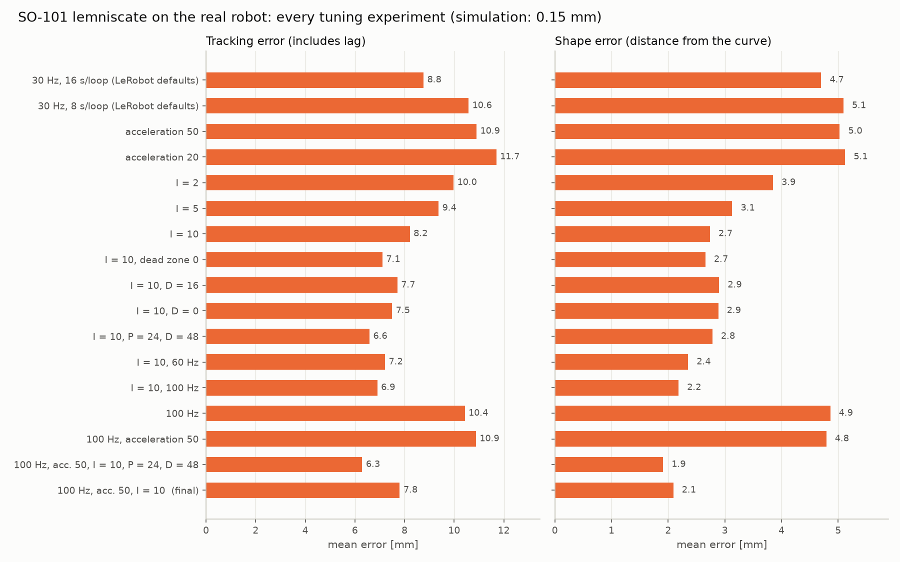
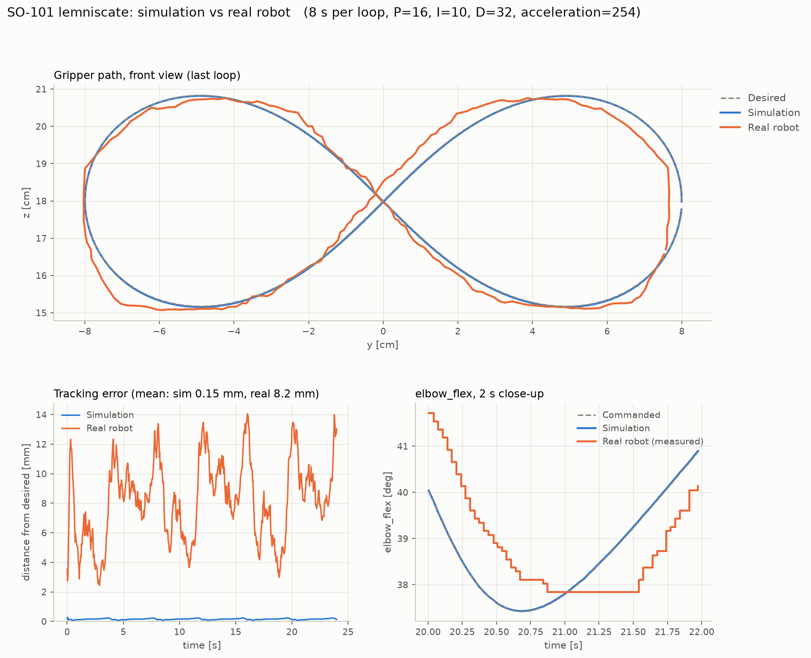
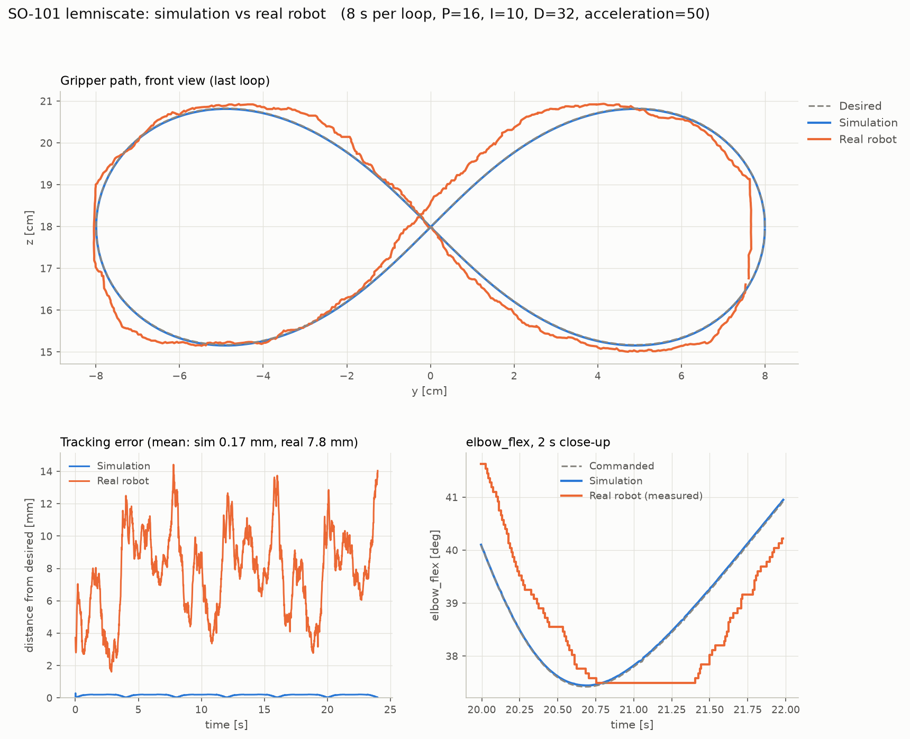

# Lemniscate: from simulation to the real SO-101

The SO-101 follower arm draws a lemniscate of Bernoulli (an "infinity sign")
with its gripper: first in MuJoCo, then on the real robot, with the same
joint commands. No camera and no leader arm are needed.

The goal is to build the sim-to-real pipeline (inverse kinematics, joint
conventions, command streaming) and to measure, with numbers and plots, how
far the real robot is from the simulation and why.



**Result.** In simulation the gripper follows the curve within 0.15 mm. On the
real robot, with LeRobot's default servo settings, the figure is drawn with a
5 mm mean shape error and visibly sags. After the tuning described below, the
real gripper stays within **2.1 mm** of the curve on average. The remaining
difference comes from the servos themselves: encoder resolution, backlash,
dead zone, static friction and lag.

| | Mean shape error | Mean tracking error (includes lag) |
|---|---|---|
| Simulation | 0.15 mm | 0.15 mm |
| Real robot, LeRobot defaults | 5.1 mm | 10.6 mm |
| Real robot, final configuration | **2.1 mm** | **7.8 mm** |

## Contents

1. [Pipeline](#pipeline)
2. [Files and how to run them](#files-and-how-to-run-them)
3. [Inverse kinematics](#inverse-kinematics)
4. [Simulation](#simulation)
5. [Checking that simulation and robot agree](#checking-that-simulation-and-robot-agree)
6. [First run on the real robot](#first-run-on-the-real-robot)
7. [Tuning, experiment by experiment](#tuning-experiment-by-experiment)
8. [Final configuration](#final-configuration)
9. [The sim-to-real gap](#the-sim-to-real-gap)
10. [Lessons learned and next steps](#lessons-learned-and-next-steps)

## Pipeline

```
lemniscate (240 points, y-z plane)
        │
        ▼
inverse kinematics in MuJoCo (SO-101 model)  ──►  outputs/trajectory.npz (joint angles)
                                                        │
                              ┌─────────────────────────┴─────────────────────────┐
                              ▼                                                   ▼
                 MuJoCo, position actuators + physics            real follower via LeRobot
                    (sim_lemniscate.py)                            (real_lemniscate.py)
                              │                                                   │
                              └──────────────► compare_sim_real.py ◄──────────────┘
                                        (forward kinematics of both, plots)
```

The inverse kinematics runs once, offline. Simulation and robot then replay
the same joint trajectory, so any difference between them comes from the
"plant" (simulated actuators vs. real servos), not from the commands.

- Robot model: `so101_new_calib.xml` from
  [TheRobotStudio/SO-ARM100](https://github.com/TheRobotStudio/SO-ARM100/tree/main/Simulation/SO101).
  In this model every joint's zero is at the middle of its range, the same
  convention as LeRobot's calibration (`use_degrees=True`), so radians convert
  to LeRobot degrees with no offset.
- Real robot: SO-101 follower (12 V version, Feetech STS3215 servos) driven
  with [LeRobot](https://github.com/huggingface/lerobot) 0.6.2 from WSL2.

## Files and how to run them

All commands run from the project root, in the `lerobot` conda environment
(plus `mujoco==3.5.0` and `matplotlib`).

| File | What it does |
|---|---|
| [`trajectory.py`](trajectory.py) | Lemniscate path, Damped Least Squares IK with a null-space posture term, trajectory solver. Shared by every script. |
| [`sim_lemniscate.py`](sim_lemniscate.py) | Solves the IK, saves `outputs/trajectory.npz` and plays it in the MuJoCo viewer with physics. |
| [`check_joint_signs.py`](check_joint_signs.py) | Digital twin: the real arm (torque off, moved by hand) is mirrored in MuJoCo, to check joint zeros and directions. |
| [`real_lemniscate.py`](real_lemniscate.py) | Replays the trajectory on the real follower and logs commanded and measured joints to `outputs/real_run_*.npz`. |
| [`compare_sim_real.py`](compare_sim_real.py) | Replays a real run's commands in simulation and plots desired, simulated and real paths, tracking error and a joint close-up. |
| [`summarize_runs.py`](summarize_runs.py) | Tracking and shape error of every tuning experiment ([figure](figures/tuning_summary.png)). |
| [`render_sim.py`](render_sim.py) | Still image of the simulated robot on the lemniscate. |
| [`../scripts/check_motors.py`](../scripts/check_motors.py) | Pings the six motors and lists the IDs on the bus. |
| [`../scripts/set_dead_zone.py`](../scripts/set_dead_zone.py) | Reads or writes the servos' dead zone (EEPROM, permanent). |

```bash
# 1. IK + simulation (writes outputs/trajectory.npz)
python lemniscate/sim_lemniscate.py                  # with viewer
python lemniscate/sim_lemniscate.py --no-viewer      # compute and save only

# 2. Check joint zeros and directions (hold the arm: torque is released)
python lemniscate/check_joint_signs.py

# 3. Real robot, final configuration
python lemniscate/real_lemniscate.py --period 8 --fps 100 --acceleration 50 --i-gain 10

# 4. Plots
python lemniscate/compare_sim_real.py                # latest run
python lemniscate/summarize_runs.py
```

`real_lemniscate.py` moves the arm to the first point in 5 s, waits for
ENTER, draws the loops, then brings the arm back to where it started. Every
command is clipped to 5° from the present position (`--max-step`), and
Ctrl+C stops the loops and returns to the start pose.

## Inverse kinematics

Adapted from my ETH robot-learning course (HW2, SO-100), ported to the
SO-101 model.

**Path.** 240 points of the lemniscate `y = a cos t / (1 + sin² t)`,
`z = a cos t sin t / (1 + sin² t)`, with half-width a = 8 cm, 25 cm in front
of the base, centred at 18 cm height. That is one point per command at
30 Hz for an 8 s loop. The figure was scaled down from the course's ±25 cm
because the SO-101 reaches about 40 cm.

**Solver.** Damped Least Squares on the gripper position only:

```
dq = J⁺ e,   J⁺ = Jᵀ (J Jᵀ + λI)⁻¹
```

with J the 3×4 position Jacobian of the gripper site (`gripperframe`) with
respect to `shoulder_pan`, `shoulder_lift`, `elbow_flex`, `wrist_flex`.
`wrist_roll` (it rotates the gripper about its own axis) and `gripper` (it
does not move the site) stay fixed. Each point starts from the previous
solution (warm start), and the joints are clipped to the model's limits.

**Redundancy and the null-space term.** Four joints for a 3D position leave
one redundant degree of freedom: the same gripper position can be reached
with infinitely many elbow/wrist combinations. With warm start only, the
posture drifted along the loop: back at the start point, the gripper was in
the same place but the elbow was 1.2° off, so every loop ended with a jump.
The fix is a null-space term that pulls the joints towards a reference
posture q_ref (the solution at the first point) without moving the gripper:

```
dq = J⁺ e + (I − J⁺ J) k (q_ref − q)
```

The posture now depends only on the target, not on the path taken, and the
loop closes.

| | Max step between commands (elbow) | Jump from last to first point (elbow) |
|---|---|---|
| Warm start only | 0.25° | 1.19° |
| With null-space term | 0.25° | 0.25° |

Max IK error over the 240 points: 0.09 mm.

## Simulation

`sim_lemniscate.py` sends the joint trajectory to MuJoCo's position actuators
(`data.ctrl`) at 30 Hz and steps the physics in between, as the real servos
receive goal positions. The simulated gripper follows the curve with a
**0.15 mm** mean error (0.3 mm max).

Two practical notes for WSL2:

- MuJoCo rendered on the CPU (`llvmpipe`, about 3 FPS for this model). With
  `GALLIUM_DRIVER=d3d12`, Mesa uses the integrated GPU through WSL's D3D12
  bridge (about 23 FPS offscreen).
- The SO-101 meshes come straight from CAD: about 320,000 triangles, 5×
  the MuJoCo Menagerie SO-100 model used in the course. Drawing hundreds of
  marker spheres per frame on top of that made the viewer crawl: keep markers
  few.

## Checking that simulation and robot agree

Before sending a simulated trajectory to the real arm, the zero and the
direction of every joint must match: one inverted sign and the arm moves
somewhere unexpected.

`check_joint_signs.py` disables the torque, reads the real joint angles at
20 Hz and writes them into the MuJoCo model (`data.qpos` + `mj_forward`,
kinematics only, no physics). Moving the real arm by hand, the model mirrors
it. All five arm joints matched in zero and direction, so the trajectory is
used without corrections. (The gripper is mapped linearly from LeRobot's
0–100 % to the model's joint range, for display only.)

## First run on the real robot

LeRobot defaults: servo gains P = 16, I = 0, D = 32, acceleration 254
(maximum), commands at 30 Hz, 8 s per loop.



- **The figure sags.** The upper lobes are about 1.2 cm too low and the side
  ends are flattened.
- **Large periodic errors**, up to 22 mm, twice per loop.
- **The elbow stalls.** In the close-up, it stops 2.3° (about 26 encoder
  ticks) before the turning point and stays still for about 1 s while the
  command goes down and up again.
- **The motion is jerky.** The measured joints move in steps.

## Tuning, experiment by experiment

Each experiment changed one setting, with a hypothesis to test. The servo
settings are passed to `real_lemniscate.py`:

```bash
--period     seconds per loop
--fps        commands per second
--p-gain / --i-gain / --d-gain    servo position PID gains (written by LeRobot at connect)
--acceleration                    servo acceleration register, 0-254 (RAM, not persistent)
```



The **tracking error** is the distance between the real gripper and where it
should be at that instant. The **shape error** is the distance from the
closest point of the curve, whatever the timing: it says how well the figure
is drawn.

### 1. Speed (16 s vs 8 s per loop)

*Hypothesis: a slower trajectory is easier to follow.* Slower was not
smoother. At 16 s per loop, most joints move less than one encoder tick
(0.088°) per command, so the servo stays still most of the time and then
catches up at once (stick-slip). The elbow was frozen in 68 % of the cycles at
16 s and 56 % at 8 s. 8 s per loop is used from here on.

### 2. Proportional gain P (16 → 24 → 32)

*Hypothesis: a stiffer servo overcomes friction sooner.* The mean error
went down, but the arm vibrated and both runs were stopped early. LeRobot
halves Feetech's default (32) for this reason.

### 3. Acceleration (254 → 50 → 20)

*Hypothesis: with maximum acceleration, every small goal is reached with an
abrupt start and stop.* LeRobot sets the servos' acceleration register to
the maximum at connect. Lower values made the motion slightly softer, with a
little more lag (tracking 10.6 → 11.7 mm). The shape did not change.

### 4. Dead zone (1 → 0)

*Hypothesis: the servos tolerate a 1-tick error before correcting
(`CW_Dead_Zone`/`CCW_Dead_Zone` = 1), so they wait for a 2-tick error and
then jump.* Setting it to 0 (EEPROM) made no visible or measurable
difference to the shape (2.7 mm with or without). This hypothesis was wrong,
and the dead zone was restored to the factory value 1.

### 5. Integral gain I (0 → 2 → 5 → 10)

*Hypothesis: the servo's controller is P-only (LeRobot sets I = 0), so under
the weight of the forearm a joint settles where P × error balances gravity,
leaving a steady-state error.* This was the decisive change: the shape error
went from 5.1 to 3.9, 3.1 and **2.7 mm**. The upper lobes now reach the top
and the elbow reaches its turning point.



What is left is mostly **lag**. Shifting the measured joints in time to best
match the commands, the joints lag by about 133 ms (elbow: 233 ms), and
removing that lag would bring the mean tracking error from 8.2 to 3.1 mm.

### 6. Derivative gain D (32 → 16 → 0, and P 24 with D 48)

*Hypothesis: on a tick-quantised encoder, the D term sees each tick as a
sudden movement and brakes it.* D = 16 and D = 0 changed nothing. P = 24
with D = 48 no longer vibrated and gave the lowest tracking error at 30 Hz
(6.6 mm), but the shape stayed the same (2.8 mm).

### 7. Command rate (30 → 60 → 100 Hz)

*Hypothesis: the jerkiness happens everywhere, not only where joints
reverse.* Counting the abrupt movements (3 ticks or more in one cycle) of
the I = 10 run, about 90 % happened during normal motion, and their
distribution was the same for every P, I, D tested. The cause is the command
stream itself: every 33 ms a new goal arrives a few ticks ahead, the servo
reaches it within a few milliseconds and then waits. The motion is a 30 Hz
staircase.

The bus is fast enough for more: one write + read cycle for the six motors
takes 2.3 ms on average (through WSL's USB forwarding), so 100 Hz leaves a
wide margin. At 100 Hz the motion felt smoother and the shape error went down
to 2.2 mm. Small vibrations appeared where joints reverse (centre and ends
of the figure), with or without I. Gear backlash is the likely cause there.

## Final configuration

```bash
python lemniscate/real_lemniscate.py --period 8 --fps 100 --acceleration 50 --i-gain 10
```

| Setting | Value | Why |
|---|---|---|
| Command rate | 100 Hz | Breaks the 30 Hz staircase |
| Acceleration | 50 | Softer reaction to each goal, especially at reversals |
| I gain | 10 | Removes the sag caused by gravity |
| P, D gains | 16, 32 (LeRobot defaults) | No vibration risk |



Mean shape error **2.1 mm** (max 6.7 mm), tracking error 7.8 mm, elbow lag
about 220 ms. P = 24 with D = 48 on top of this was slightly more precise
(shape 1.9 mm, tracking 6.3 mm). By eye, the two looked the same.

None of these settings is permanent: P, I, D and acceleration are written to
the servos' RAM when the script connects, and other LeRobot commands
(teleoperation, recording) still use the defaults.

## The sim-to-real gap

The simulated actuator is an ideal position controller: high gain
(`kp = 998`), continuous, with no dead zone and no static friction. The real
STS3215 differs in ways the model does not capture:

| Real servo | Effect on the lemniscate |
|---|---|
| Encoder resolution: 4096 ticks per turn (0.088°) | Slow motion becomes steps of whole ticks |
| P-only position control (LeRobot default I = 0) | Steady-state error under gravity: the figure sags |
| Static friction | A joint needs some error before it starts moving: stick-slip |
| Gear backlash (the model itself assumes about ±0.5°) | Pauses and small vibrations where a joint reverses |
| Dead zone (±1 tick) | No correction for 1-tick errors |
| Acceleration profile | Each goal is reached with an abrupt start and stop |
| Lag (130–230 ms here) | The gripper passes through the right points, but late |

Same commands, two "plants": this is the gap a policy trained in
simulation has to cross.

A limit of these measurements: the logs only contain joint positions, read
in whole ticks. Vibrations smaller than a tick, or faster than the logging
rate, do not show up, which is why the jerkiness indices barely changed
between runs that felt different. Logging the motor current
(`Present_Current`) would make them measurable.

## Lessons learned and next steps

- Check joint conventions with a read-only digital twin before sending any
  simulated trajectory to the robot.
- Change one setting at a time and keep every run's log: several plausible
  hypotheses (dead zone, D gain) turned out to be wrong, and only the data
  showed it.
- Separate the error into lag and shape: they have different causes and
  different fixes.
- For smooth motion on these servos, the command rate matters more than the
  PID gains.

Possible improvements:

- **Feedforward lag compensation**: send each joint the command from about
  130–230 ms ahead. The analysis above suggests the tracking error would drop
  from about 8 to about 3 mm.
- **Goal velocity**: the STS3215 also accepts a target speed, so the servo
  could move continuously between goals instead of rushing to each one.
- **Model the real servo in MuJoCo** (lower gain, friction, backlash) to
  shrink the gap from the simulation side.
